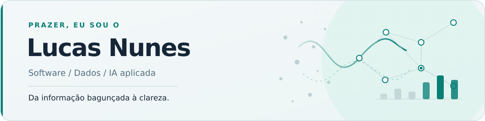

  <picture>
    <source media="(prefers-color-scheme: dark)" srcset="assets/hero-dark.svg">
    <source media="(prefers-color-scheme: light)" srcset="assets/hero-light.svg">
    
  </picture>

# Oi, eu sou o Lucas 👋

Antes de aprender a programar, eu já gostava de entender por que as coisas paravam de funcionar. Começou com o computador de casa, por volta dos 10 anos. Hoje, a curiosidade é parecida, só mudaram os problemas: uma base com registros inconsistentes, uma API que não responde como deveria ou um modelo que precisa ser comparado com uma alternativa mais simples.

Na **Residência Tecnológica da UCB**, trabalhei com dados duplicados, valores ausentes e formatos diferentes. Parte do tratamento era manual; passei a criar rotinas em Python para limpar e padronizar essas informações. Ali percebi que gosto tanto de investigar a origem de um problema quanto de escrever o código que resolve uma parte dele.

Estudo **Engenharia na Universidade de Brasília (UnB)** e tenho direcionado meus projetos para **software, dados e IA aplicada**. Também gosto de construir interfaces: para mim, uma boa solução precisa funcionar por dentro e fazer sentido para quem vai usá-la.

## Projetos que valem abrir

Dois projetos em que tentei ir além de colocar um modelo para funcionar: **entender a decisão que ele ajuda a tomar** e **testar os limites dos resultados**.

<table>
  <tr>
    <td width="50%" valign="top">
      
      <h3><a href="https://github.com/lucastnunes06/pedidopulse-ai-operations">PedidoPulse</a></h3>
      
<strong>Quais pedidos merecem atenção primeiro?</strong> Experimentei previsões de atraso, regras de triagem e consulta a políticas. O desafio mais interessante foi medir como um limiar diferente muda a quantidade de alertas.

      
<code>Python</code> <code>scikit-learn</code> <code>FastAPI</code>

      Protótipo com dados e operações fictícios.
    </td>
    <td width="50%" valign="top">
      
      <h3><a href="https://github.com/lucastnunes06/ranklab-recommender-system">RankLab</a></h3>
      
<strong>Uma boa recomendação é só a de maior score?</strong> Comparei modelos e baselines, tratei restrições de preço e testei o equilíbrio entre relevância e variedade das sugestões.

      
<code>Python</code> <code>Ranking</code> <code>FastAPI</code>

      Restaurantes e sessões gerados artificialmente.
    </td>
  </tr>
</table>

### Outros projetos que mostram lados diferentes do meu trabalho

- **[SyndromeBench](https://github.com/lucastnunes06/syndromebench-embeddings)** — Um estudo de classificação de embeddings com KNN, distâncias cosseno e euclidiana e validação por indivíduo. O foco é metodológico; **não é um sistema de diagnóstico**, e o dataset original não é distribuído.
- **[Plash](https://github.com/lucastnunes06/Plash2)** — Meu projeto final do HackaTruck: um aplicativo iOS de acompanhamento do consumo de água, feito em SwiftUI, com integração à API Gemini para dicas de economia.
- **[Sistema de Solicitações](https://github.com/lucastnunes06/sistema_solicitacoes)** — Uma aplicação web em C# e ASP.NET Core Minimal API para registrar e acompanhar pedidos internos. Procurei manter a arquitetura proporcional ao problema.

Também explorei **threads, locks e semáforos** no [NeuroCity](https://github.com/lucastnunes06/NeuroCity), um projeto de simulação de concorrência.

## Ferramentas que uso

| Área | Tecnologias e práticas |
| --- | --- |
| **Dados e Machine Learning** | Python, SQL, Pandas, NumPy, scikit-learn, visualização de dados |
| **APIs e software** | FastAPI, C#, ASP.NET Core, JavaScript, HTML, CSS, APIs REST |
| **Mobile** | Swift, SwiftUI, integração com serviços externos |
| **Desenvolvimento** | Git, GitHub, Docker, testes automatizados, CI/CD |

Não tento encaixar todas essas tecnologias no mesmo projeto. Prefiro escolher ferramentas que façam sentido para o problema e deixar os testes e a documentação mostrarem o que realmente funciona.

## Um pouco da trajetória

- **UnB:** graduação em Engenharia, com interesse em software, dados e sistemas inteligentes.
- **Residência Tecnológica UCB (2025):** projetos orientados com mentoria e trabalho com tratamento e padronização de dados.
- **HackaTruck MakerSpace (2025, 100 horas):** desenvolvimento iOS, APIs REST, serviços em nuvem e projeto final em SwiftUI.

## Vamos conversar?

**[LinkedIn](https://www.linkedin.com/in/eulucastnunes/)** · **[lucastnunes06@gmail.com](mailto:lucastnunes06@gmail.com)**

**Celular:** +55 (61) 99213-8697

Se algum projeto chamar sua atenção, gosto de conversar sobre o que funcionou, o que deu errado e o que eu mudaria na próxima versão.
